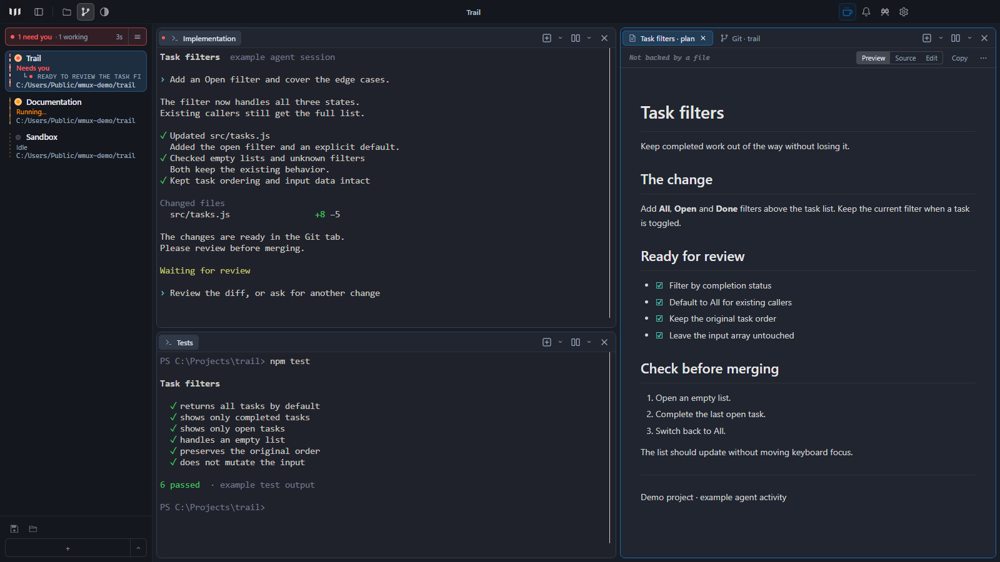
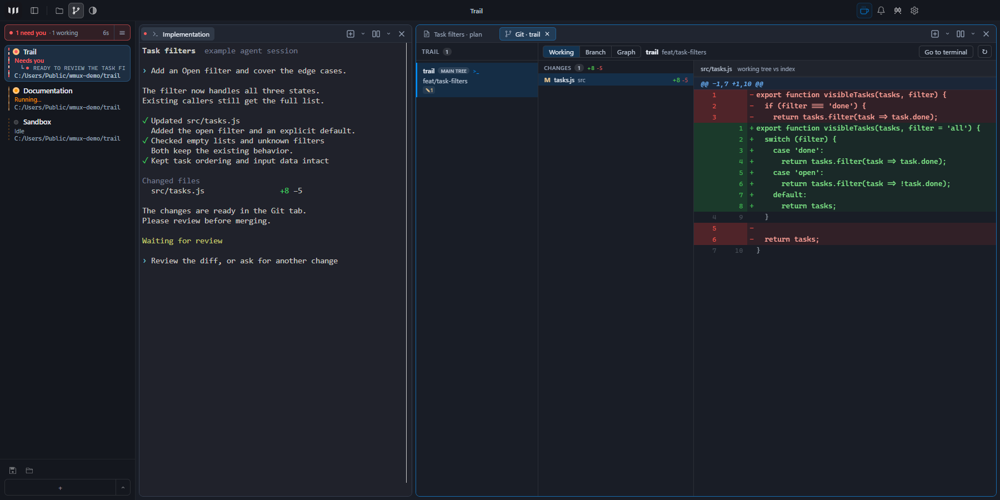

<p align="center">
  
</p>

<h1 align="center">wmux</h1>

<p align="center">A Windows terminal for working with several coding agents at once.</p>

<p align="center">
  <a href="https://github.com/amirlehmam/wmux/releases/latest">Download for Windows</a> ·
  <a href="#install">Install</a> ·
  <a href="#keyboard-shortcuts">Shortcuts</a> ·
  <a href="#documentation">Documentation</a> ·
  <a href="https://github.com/amirlehmam/wmux/releases">Release notes</a>
</p>



*Captured in wmux 2.51.0. The screenshots use a demo project with example terminal output and agent states.*

Run an agent, keep your tests beside it, and review the changes in the same window. The sidebar shows which workspaces are busy and which need an answer. When an agent stops for you, jump straight to its pane.

wmux runs your existing command-line tools: Claude Code, Codex, OpenCode, or an ordinary shell. Bring the tools and accounts you already use.

## Install

Download the latest **Windows x64** release:

| Format | How to use it |
| --- | --- |
| [Installer](https://github.com/amirlehmam/wmux/releases/latest) | Download `wmux-<version>-setup.exe` and run it. |
| [Portable ZIP](https://github.com/amirlehmam/wmux/releases/latest) | Download `wmux-<version>-win-x64.zip`, extract it, and run `wmux.exe`. |
| [Scoop](https://scoop.sh) | Run the commands below. |

```powershell
scoop bucket add wmux https://github.com/amirlehmam/wmux
scoop install wmux/wmux
```

Installer and ZIP installs can update through **Settings → Help → Check for updates**. For Scoop, use `scoop update wmux`. Settings and saved sessions live in `%APPDATA%\wmux`, including when you use the ZIP.

The 2.51.0 release is unsigned, so Windows may show a SmartScreen warning. Download from this repository's releases.

<details>
<summary>Update controls</summary>

Set `WMUX_DISABLE_UPDATER=1` to disable the updater. For unattended installer downloads, `WMUX_MIN_RELEASE_AGE_DAYS` sets the minimum release age (3 days by default). A manual update check bypasses that delay. Installing an update still requires confirmation.

</details>

## Start with one project

1. Open wmux and choose your shell. PowerShell, Command Prompt, Git Bash and WSL are supported.
2. Open your project folder with **Ctrl+O**, then launch your usual agent command.
3. Split right with **Ctrl+D** or down with **Ctrl+Shift+D**. Run tests, a development server, or a second agent beside the first.
4. Use **Ctrl+Shift+A** to see the agent navigator, or **Ctrl+Shift+B** to jump to an agent waiting for you.

On first launch, choose which integrations to enable. You can change them later in **Settings → General**. wmux asks before installing agent hooks or modifying configuration outside its own directory.

## Keep the work together

### Terminals and workspaces

Split panes horizontally or vertically, drag tabs between panes, and zoom a pane when you need more room. Group related terminals in a workspace; save a layout when you want to reuse the arrangement.

Each pane can have its own shell, working directory and terminal colors. The app has dark and light appearances, bundled terminal themes, and an importer for Windows Terminal and Ghostty settings.

For a repeatable project setup, commit a [`wmux.workspace.json`](docs/workspace-manifest.md). It can open the panes, folders, commands and browser tabs your project needs:

```powershell
wmux workspace open
```

### See who needs an answer

The sidebar brings together agent activity, working directories, Git branches and listening ports. The agent navigator puts blocked agents first. Notifications can bring you back when work finishes or needs input.

Activity comes from agent integrations and, for supported tools, screen detection. What wmux can report depends on the agent and how it is running; a detected agent does not always expose a reliable working or waiting state.

### Review without leaving the terminal

Open the file explorer with **Ctrl+Shift+X**, or the project Git view with **Ctrl+Alt+G**. Browse working changes, compare a branch against its base, and inspect the commit graph. The Git view stays on the repository you opened while you move between agent panes.



The file viewer handles quick edits. Markdown panes render plans and documentation, including diagrams and math. Git worktree workspaces give parallel tasks separate checkouts when they need to change the same repository.

### Keep a browser beside the code

Open a local development server or documentation in the browser panel with **Ctrl+Shift+I**. The CLI can navigate it, inspect the page, click elements and take screenshots, so you can watch browser work as it happens.

Links can open in wmux or your system browser; choose the default in **Settings → Browser**.

### Check in from your phone

The optional Remote Console shows agent activity and mirrors terminal panes in a phone browser. You can send text, use the key bar, or answer choices an agent has reported.

Enable it in **Settings → Remote**, configure access through Tailscale or an SSH tunnel, then pair your device. It is off by default and listens on loopback by default. The settings page includes connection instructions and device revocation.

### Pick up where you left off

wmux restores workspace layouts, tabs and working directories. Shells start again; running processes do not survive a restart.

Agent conversation restore has separate opt-in switches in **Settings → Workspace**. See the compatibility notes for [Codex](docs/codex-session-restore.md) and [omp](docs/omp-session-restore.md).

Saving terminal output across restarts is also opt-in, under **Settings → Terminal → Scrollback**. Saved output is local, unencrypted text and can contain anything printed in the terminal. Named sessions do not archive that output.

## Keyboard shortcuts

| Action | Default shortcut |
| --- | --- |
| Open a project folder | **Ctrl+O** |
| New workspace | **Ctrl+N** |
| New tab | **Ctrl+T** |
| Split right / down | **Ctrl+D** / **Ctrl+Shift+D** |
| Move focus between panes | **Ctrl+Alt+Arrow** |
| Zoom the current pane | **Ctrl+Shift+Enter** |
| Agent navigator | **Ctrl+Shift+A** |
| Jump to a waiting agent | **Ctrl+Shift+B** |
| File explorer | **Ctrl+Shift+X** |
| Project Git view | **Ctrl+Alt+G** |
| Browser panel | **Ctrl+Shift+I** |
| Markdown pane | **Ctrl+Shift+M** |
| Command palette | **Ctrl+Shift+P** |
| Settings | **Ctrl+,** |
| Shortcut reference | **Ctrl+F1** |

Rebind shortcuts in **Settings → Keyboard**. The workspace and tab number-row shortcuts can be changed or disabled there too.

## CLI

`wmux` is available inside the terminals it opens. It talks to the running app over a named pipe.

```powershell
wmux ping
wmux new-workspace --title "Frontend" --panes 2 --layout columns
wmux list-workspaces
wmux tree

# Inspect agent activity and terminal output
wmux agent-state
wmux read-screen --lines 50

# Open a plan or a local preview
wmux markdown docs/plan.md
wmux browser open http://localhost:3000
wmux browser snapshot

# Notify yourself when a script finishes
wmux notify "Tests finished"

# Open an SSH workspace
wmux ssh user@host --title "Remote"
```

Run `wmux help` for the command list, or `wmux <command> --help` for usage. Commands that target a terminal accept a surface ID where documented, so scripts can address a specific tab.

For containers and remote setups, see the [devcontainer guide](docs/DEVCONTAINER.md). Paste and drop can upload files in direct SSH panes; [configuration and limitations](docs/config.md#remote-file-upload) cover when that applies.

## Documentation

| Guide | What it covers |
| --- | --- |
| [Configuration](docs/config.md) | `~/.wmux/config.toml`, themes, key remaps and file uploads |
| [Workspace manifests](docs/workspace-manifest.md) | Project layouts, startup commands and dependencies |
| [WSL file explorer](docs/wsl-explorer.md) | Directory reporting and files across Windows and WSL |
| [Devcontainers](docs/DEVCONTAINER.md) | Connecting container shells to the desktop app |
| [OpenCode integration](docs/opencode-plugin.md) | Plugin behavior, compatibility and troubleshooting |
| [Codex session restore](docs/codex-session-restore.md) | Resuming the right conversation in each tab |
| [omp session restore](docs/omp-session-restore.md) | Transcript tracking and restore behavior |
| [Crash reports](docs/crash-reports.md) | Collecting a useful report without sending a memory dump |

Looking for a recent change? See the [release notes](https://github.com/amirlehmam/wmux/releases).

## Build and contribute

wmux uses Electron, React, TypeScript, Zustand, xterm.js and node-pty/ConPTY.

On Windows, with Git and a current Node.js LTS installed:

```powershell
git clone https://github.com/amirlehmam/wmux.git
cd wmux
npm ci
npm run build:main
npm run dev
```

Use a short checkout path without spaces, such as `C:\dev\wmux`, to avoid native build and packaging issues.

```powershell
npm test
npm run typecheck
npm run lint
npm run build:renderer
```

The main process lives in `src/main`, the UI in `src/renderer`, and the CLI in `src/cli`. [AGENTS.md](AGENTS.md) describes the module boundaries and development conventions. Release builds run in GitHub Actions when a version tag is pushed.

[Open an issue](https://github.com/amirlehmam/wmux/issues) for a bug or feature request, or start a [discussion](https://github.com/amirlehmam/wmux/discussions). For bugs, include the wmux version, shell, reproduction steps and what you expected. For crashes, start with `wmux crash-report`; do not attach a memory dump, which can contain credentials.

## Credits and license

wmux is an independent Windows implementation inspired by [cmux](https://github.com/manaflow-ai/cmux). It does not reuse cmux's source code. The agent visibility model was also influenced by [herdr](https://github.com/herdrdev/herdr).

Licensed under [MIT](LICENSE).
